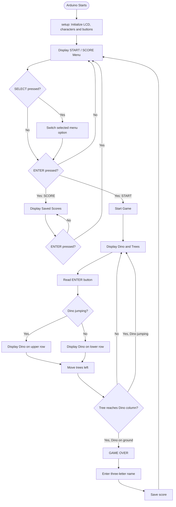
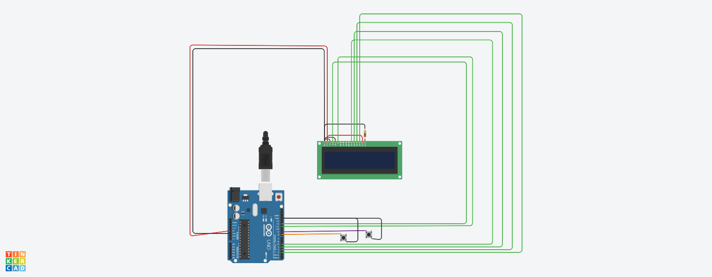

# Dino Game Using Arduino

A simple implementation of the classic Google Chrome Dinosaur Game using an Arduino UNO, a 16×2 LCD, and two push buttons. The project recreates the basic gameplay experience, including jumping over obstacles, collision detection, score tracking, and player name entry.

## Aim

To design and implement a Dinosaur Game using an Arduino UNO and a 16×2 LCD display.

## Purpose

The purpose of this project is to mimic the Chrome Dino Game using embedded hardware. The dinosaur jumps over incoming obstacles, and the player earns points by surviving for as long as possible.

## Features

- Custom dinosaur and tree characters using LCD CGRAM.
- Menu with START and SCORE options.
- Two-button control system.
- Dinosaur jumping mechanism.
- Randomized obstacle spacing.
- Obstacle movement and collision detection.
- Score calculation.
- Three-character player name entry.
- Score history displayed on the LCD.

## Hardware Requirements

- Arduino UNO
- 16×2 LCD Display
- 2 Push Buttons
- 1K Ohm Resistor
- Breadboard
- Jumper Wires
- USB Cable for programming and power

## Software Requirements

- Arduino IDE
- LiquidCrystal library (included with the standard Arduino IDE library package)
- Tinkercad Circuits (for simulation)

## Circuit Connections

The LCD is connected to the Arduino using a 4-bit parallel interface.

| LCD Pin | Arduino Connection |
|---|---|
| RS | 12 |
| E | 11 |
| D4 | 5 |
| D5 | 4 |
| D6 | 3 |
| D7 | 2 |
| VSS | GND |
| VDD | 5V |
| V0 | GND |
| R/W | GND |

The push buttons are connected as follows:

| Button | Arduino Pin |
|---|---|
| ENTER | 8 |
| SELECT | 9 |

Both buttons use the Arduino's internal pull-up resistors (`INPUT_PULLUP`), so pressing a button connects its input pin to GND.

The LCD backlight is connected to 5V and GND, using a current-limiting resistor where required by the display module.

## Working / Workflow

1. **Initialization:** The Arduino initializes the LCD, configures the push buttons, and registers the custom dinosaur and tree characters.
2. **Main Menu:** The LCD displays two options: START and SCORE. The SELECT button navigates between them, while ENTER confirms the selection.
3. **Game Initialization:** Selecting START initializes the game and begins displaying the dinosaur and obstacles.
4. **Dinosaur Movement:** The ENTER button controls the dinosaur. Pressing it displays the dinosaur on the upper LCD row, creating the appearance of a jump. Releasing it returns the dinosaur to the lower row.
5. **Obstacle Movement:** Trees are displayed as custom LCD characters and move from right to left by decrementing their column positions.
6. **Collision Detection:** The program checks whether an obstacle reaches the dinosaur's column while the dinosaur is on the ground. If so, the game ends.
7. **Score Calculation:** The score increases as the player survives obstacle movement iterations.
8. **Name Entry:** After the game ends, the player enters a three-character name using SELECT to cycle through letters and ENTER to confirm.
9. **Score Display:** The score and player name are stored in an array and can be viewed through the SCORE option in the main menu.

## Setup Instructions

1. Assemble the circuit according to the connection table and circuit diagrams.
2. Connect the Arduino UNO to your computer using a USB cable.
3. Open `Dino_Game.ino` in the Arduino IDE.
4. Ensure that the LiquidCrystal library is available.
5. Select the appropriate Arduino board and COM port.
6. Upload the code to the Arduino UNO.
7. Start the simulation or power the circuit to play the game.

## Game Flowchart

The following flowchart illustrates the overall working of the Arduino Dino Game, from initialization and menu navigation to gameplay, collision detection, and score saving.

## Project Images

### Circuit Diagram

### Schematic Diagram

[View Schematic Diagram (PDF)](images/Schematic-Diagram.pdf)

## Demo Video

[Watch the Dino Game Simulation](images/Dino_Game_Using_Arduino_Simulation.mp4)

## Limitations and Future Improvements

- Implement non-blocking timing using `millis()` instead of multiple `delay()` calls.
- Add button debouncing for more reliable input handling.
- Implement timed jumping instead of requiring the player to hold the ENTER button.
- Store scores permanently using Arduino EEPROM.
- Improve obstacle generation and game difficulty progression.
- Optimize LCD updates to reduce screen flickering.

## Author

**Ritik Yadav**

Department of Computer Science and Engineering  
National Institute of Technology Rourkela

## License

This project is available for educational and learning purposes.
